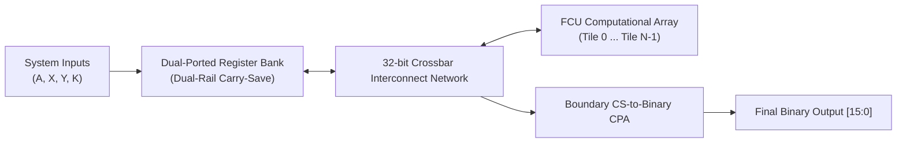
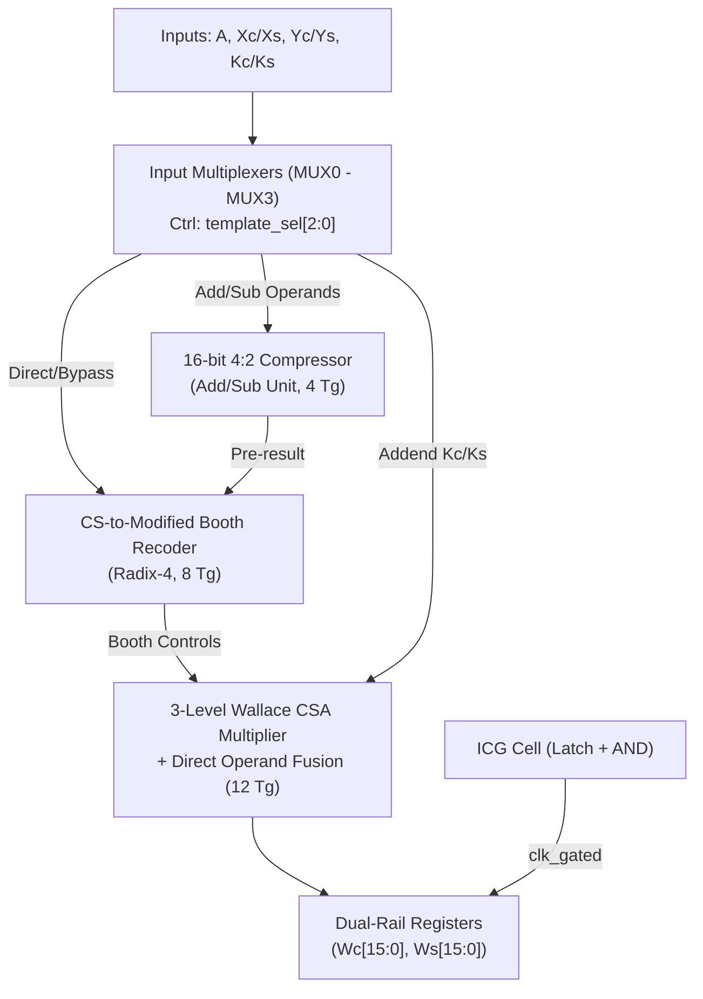
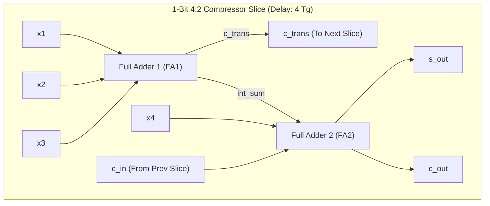
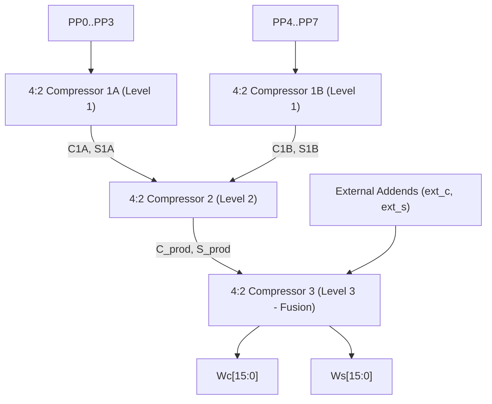
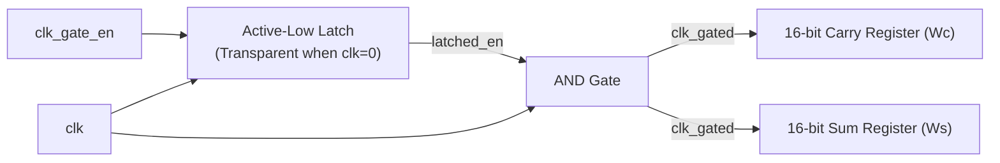
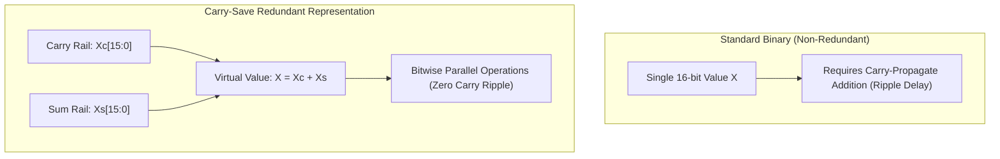
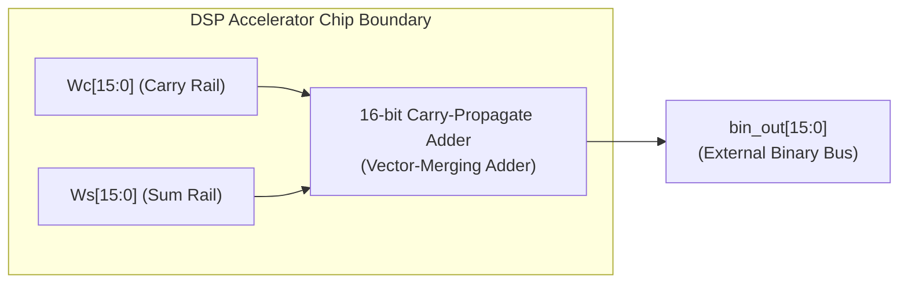
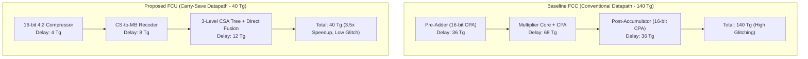

# AI Architecture Diagram Generation Guide & Prompts

A structured prompt and specification manual for generating all 10 core architectural diagrams of the **Flexible DSP Accelerator Exploiting Carry-Save Arithmetic**.

---

## Architecture Index

1. [Overall System Architecture](#1-overall-system-architecture)
2. [Detailed FCU Microarchitecture](#2-detailed-fcu-microarchitecture)
3. [16-bit 4:2 Carry-Save Compressor Bit-Slice](#3-16-bit-42-carry-save-compressor-bit-slice)
4. [Modified Booth Recoding Architecture](#4-modified-booth-recoding-architecture)
5. [Three-Level Wallace CSA Multiplier Reduction Tree](#5-three-level-wallace-csa-multiplier-reduction-tree)
6. [Dual-Rail Integrated Clock Gating (ICG)](#6-dual-rail-integrated-clock-gating-icg)
7. [Carry-Save Representation Concept ($X^* = \{X_C, X_S\}$)](#7-carry-save-representation-concept)
8. [Boundary Carry-Save to Binary (CS-to-Bin) Converter](#8-boundary-carry-save-to-binary-cs-to-bin-converter)
9. [Existing Baseline FCC vs. Proposed FCU Datapath](#9-existing-baseline-fcc-vs-proposed-fcu-datapath)
10. [Complete System Processing Flowchart](#10-complete-system-processing-flowchart)

---

## 1. Overall System Architecture

### Conceptual Flow
$$\text{Inputs} \longrightarrow \text{Register Bank} \longrightarrow \text{Crossbar Interconnect} \longrightarrow \text{FCU Cluster} \longrightarrow \text{Boundary Converter} \longrightarrow \text{Output}$$

- **Input / Scratchpad**: Dual-rail register file storing redundant operands $\{C, S\}$.
- **Crossbar Switch**: 32-bit dual-rail bus routing inputs directly between registers and FCU tiles.
- **FCU Processing Unit**: Core computational engine ([`rtl/fcu_top.v`](file:///c:/Users/LENOVO/OneDrive/Documents/majar_project/1.Flexible%20DSP%20Accelerator%20Architecture%20Exploiting%20Carry-Save%20Arithmetic/rtl/fcu_top.v)).
- **Boundary CS-to-Bin**: Single vector-merging adder at chip boundary ([`rtl/cs_to_bin.v`](file:///c:/Users/LENOVO/OneDrive/Documents/majar_project/1.Flexible%20DSP%20Accelerator%20Architecture%20Exploiting%20Carry-Save%20Arithmetic/rtl/cs_to_bin.v)).

### AI Image Generator Prompt
> **Prompt**:  
> 2D technical block diagram of a digital VLSI DSP accelerator chip, white background, clean vector IEEE style. Flow left to right: External Inputs enter a "Dual-Ported Register Bank", connected via a "32-bit Dual-Rail Crossbar Switch" to an array of "Flexible Computational Units (FCU 0, FCU 1)". FCU dual-rail outputs loop back to the crossbar or feed a "Boundary CS-to-Binary Converter (CPA)" leading to "System Output". Blue and dark green rectangular blocks, sharp thin black borders, labeled bus arrows [15:0]. No 3D tilt, high contrast.

### Mermaid Diagram


---

## 2. Detailed FCU Microarchitecture

### Conceptual Flow
$$\{X^*, Y^*, K^*, A\} \longrightarrow \text{MUX0–MUX3} \longrightarrow \text{Pre-Compressor} \longrightarrow \text{CS-to-MB Recoder} \longrightarrow \text{CSA Tree Multiplier} \longrightarrow \text{Dual-Rail Regs}$$

- **MUX0–MUX3**: Template steering multiplexers driven by `template_sel[2:0]`.
- **4:2 Pre-Compressor**: Computes $(X \pm Y)$ in carry-save format ($4\,T_g$).
- **CS-to-MB Recoder**: Encodes carry-save multiplier into Radix-4 Booth controls ($8\,T_g$).
- **CSA Multiplier Tree**: Computes product and fuses addend $K$ in carry-save ($12\,T_g$).
- **Output Registers**: Gated registers holding $W_C$ and $W_S$.

### AI Image Generator Prompt
> **Prompt**:  
> Microarchitecture block diagram of a Carry-Save Flexible Computational Unit (FCU), white background, technical schematic. Inputs enter four control multiplexers "MUX0 to MUX3". MUX outputs route into: 1) "16-bit 4:2 Carry-Save Compressor (Add/Sub)", 2) "CS-to-Modified Booth Recoder", and 3) "3-Level Wallace CSA Multiplier Tree" with fused addend inputs. Outputs connect to "Dual-Rail Pipeline Registers (Wc, Ws)" controlled by an "ICG Clock Gating Cell". Sharp boxes, cyan and dark blue blocks, labeled buses [15:0], zero 3D perspective.

### Mermaid Diagram


---

## 3. 16-bit 4:2 Carry-Save Compressor Bit-Slice

### Conceptual Flow
$$\{x_1, x_2, x_3, x_4, c_{\text{in}}\} \longrightarrow \text{FA1} \longrightarrow \text{FA2} \longrightarrow \{c_{\text{out}}, s_{\text{out}}, c_{\text{trans}}\}$$

- **Cascaded Structure**: Two Full Adders (FA1 and FA2) per bit slice.
- **Independent Transfer Carry**: $c_{\text{trans}}$ generated by FA1 from $(x_1, x_2, x_3)$ without waiting for $c_{\text{in}}$.
- **Subtraction Mode**: Inverts $Y$ inputs and sets dual carry-ins `cin1 = 1`, `cin2 = 1`.
- **Delay**: Constant $4\,T_g$, independent of bit-width.

### AI Image Generator Prompt
> **Prompt**:  
> Gate-level digital logic circuit schematic of a 4:2 carry-save compressor bit-slice, crisp 2D vector style. Shows two cascaded full adders: "Full Adder 1" receives inputs x1, x2, x3 and produces an intermediate sum and a transfer carry c_trans. "Full Adder 2" receives the intermediate sum, input x4, and horizontal carry-in c_in, outputting sum bit s_out and carry bit c_out. Blue logic blocks, standard logic pin labels, horizontal carry propagation dashed line, pure white background.

### Mermaid Diagram


---

## 4. Modified Booth Recoding Architecture

### Conceptual Flow
$$\{C[15:0], S[15:0]\} \longrightarrow \text{3-Stage Recoder} \longrightarrow \text{8 Radix-4 Digits} \longrightarrow \text{Booth MUX Array} \longrightarrow \text{8 PPs}$$

- **Stage 1**: Half-adder summation of adjacent bit pairs $(c_{2j}, s_{2j})$ and $(c_{2j+1}, s_{2j+1})$.
- **Stage 2**: Generates transfer carries strictly bounded within adjacent 2-bit slices ($t_j$).
- **Stage 3**: Decodes Booth control signals (`neg`, `one`, `two`) for digit set $\{-2, -1, 0, +1, +2\}$.
- **PP Generation**: Multiplexers select $0, \pm A, \pm 2A$ with sign extension.

### AI Image Generator Prompt
> **Prompt**:  
> Digital arithmetic architecture diagram of a Carry-Save to Modified Booth Recoder and Partial Product Generator, white background. Left: Carry-save inputs (C, S) enter a 3-stage recoder block partitioned into 8 horizontal slices. Slices output control signals (neg, one, two) to an array of 8 "Partial Product Generators" (PP0 to PP7) that receive multiplicand A. Sharp vector schematic, pastel green and blue boxes, clean labeling, IEEE style.

### Mermaid Diagram


---

## 5. Three-Level Wallace CSA Multiplier Reduction Tree

### Conceptual Flow
$$\text{PP0–PP7} \xrightarrow{\text{Level 1}} 4\text{ Vectors} \xrightarrow{\text{Level 2}} 2\text{ Vectors (Product)} \xrightarrow[\text{+ } ext\_c, ext\_s]{\text{Level 3}} (W_C, W_S)$$

- **Level 1 (PP Compression)**:
  - Comp 1A: Compresses PP0, PP1, PP2, PP3 $\to$ $(C_{1A}, S_{1A})$.
  - Comp 1B: Compresses PP4, PP5, PP6, PP7 $\to$ $(C_{1B}, S_{1B})$.
- **Level 2 (Product Compression)**:
  - Comp 2: Compresses $(C_{1A}, S_{1A}, C_{1B}, S_{1B}) \to (C_{\text{prod}}, S_{\text{prod}})$.
- **Level 3 (Direct Operand Fusion)**:
  - Comp 3: Compresses $(C_{\text{prod}}, S_{\text{prod}}, ext\_c, ext\_s) \to (W_C, W_S)$ with zero CPA.

### AI Image Generator Prompt
> **Prompt**:  
> Structural 3-level Wallace CSA multiplier reduction tree diagram, 2D vector schematic, white background. Top shows 8 partial products (PP0 to PP7). Level 1 has two 4:2 compressors reducing 8 inputs to 4 vectors. Level 2 has one 4:2 compressor reducing 4 vectors to 2 product vectors. Level 3 has a final 4:2 compressor that fuses the 2 product vectors with external carry-save addends (ext_c, ext_s) to generate final dual-rail outputs (Wc, Ws). Labeled compression stages, dark teal blocks, clear bus widths.

### Mermaid Diagram


---

## 6. Dual-Rail Integrated Clock Gating (ICG)

### Conceptual Flow
$$\text{clk\_gate\_en} \longrightarrow \text{Active-Low Latch} \longrightarrow \text{AND Gate (with clk)} \longrightarrow \text{clk\_gated} \longrightarrow \{W_C, W_S\}\text{ Regs}$$

- **Negative-Level Latch**: Captures `clk_gate_en` when `clk = 0` and holds it stable when `clk = 1`, eliminating glitches.
- **AND Gate**: Passes the clock only when `latched_en = 1`.
- **Dual-Rail Driving**: Gated clock simultaneously clocks both the 16-bit Carry register and the 16-bit Sum register.

### AI Image Generator Prompt
> **Prompt**:  
> Electronic logic circuit schematic of an Integrated Clock Gating (ICG) cell driving dual-rail registers, white background. Shows an active-low transparent latch receiving clk_gate_en and clock clk. Latch output feeds into a 2-input AND gate with clk, producing clk_gated. clk_gated drives clock pins of two 16-bit D flip-flop register banks: "Carry Register (Wc)" and "Sum Register (Ws)". Includes timing waveform below showing glitch-free hold state when enable is low. High-contrast IEEE standard symbols.

### Mermaid Diagram


---

## 7. Carry-Save Representation Concept

### Conceptual Flow
$$\text{Integer } X \Longleftrightarrow X^* = \{X_C, X_S\} \quad \text{such that} \quad X = X_C + X_S$$

- **Redundant Format**: Numbers are stored as an unmerged carry rail $X_C$ and sum rail $X_S$.
- **Carry Elimination**: Operations produce new $(C, S)$ pairs locally in $O(1)$ time without rippling across bit positions.
- **Hardware Impact**: Doubles register storage from 16 to 32 bits, but eliminates carry-propagation delay.

### AI Image Generator Prompt
> **Prompt**:  
> Conceptual educational infographic comparing Standard Binary vs. Dual-Rail Carry-Save representation, pure white background. Top panel: standard binary number represented as single 16-bit wire. Bottom panel: carry-save redundant number represented as dual parallel rails: "Carry Rail (Xc)" and "Sum Rail (Xs)" where Value = Xc + Xs. Visual shows independent bit-wise operations without horizontal ripple carries. Clean vector graphics, blue and purple rails, mathematical annotations, high resolution.

### Mermaid Diagram


---

## 8. Boundary Carry-Save to Binary (CS-to-Bin) Converter

### Conceptual Flow
$$\{W_C[15:0], W_S[15:0]\} \longrightarrow \text{16-Bit CPA} \longrightarrow \text{Binary Output}[15:0]$$

- **Role**: Located strictly at the final accelerator cluster output boundary.
- **Operation**: Standard carry-propagate addition $W_{\text{bin}} = (W_C + W_S) \pmod{2^{16}}$.
- **Advantage**: Intermediate computations inside the accelerator remain in carry-save form; CPA latency is incurred only once upon exiting.

### AI Image Generator Prompt
> **Prompt**:  
> VLSI boundary interface schematic, white background. Shows the chip boundary dotted line. Inside the boundary: dual-rail carry-save buses Wc[15:0] and Ws[15:0]. They enter a "16-bit Carry-Propagate Adder (CPA) / Vector-Merging Adder". The single 16-bit non-redundant binary bus bin_out[15:0] crosses the chip boundary to external output pins. Simple, high-contrast, clean engineering diagram.

### Mermaid Diagram


---

## 9. Existing Baseline FCC vs. Proposed FCU Datapath

### Conceptual Flow & Timing Comparison
- **Existing FCC**: $\text{Pre-CPA } (36\,T_g) \to \text{Multiplier + CPA } (68\,T_g) \to \text{Post-CPA } (36\,T_g) = \mathbf{140\,T_g}$
- **Proposed FCU**: $\text{4:2 Compressor } (4\,T_g) \to \text{CS-to-MB } (8\,T_g) \to \text{CSA Tree + Fusion } (12\,T_g) + \text{MUX } (4\,T_g) = \mathbf{40\,T_g}$

### AI Image Generator Prompt
> **Prompt**:  
> Side-by-side comparative architecture diagram: "Conventional FCC" vs "Proposed Carry-Save FCU", white background. Left column (FCC): three sequential carry-propagate adders causing 140 Tg delay, colored pale red. Right column (FCU): 4:2 compressor, direct CS-to-MB recoder, and 3-level Wallace CSA tree with zero intermediate CPAs, total 40 Tg delay, colored pale green. Highlight the 3.5x speedup and 71% latency reduction badge. Clear IEEE style, professional font.

### Mermaid Diagram


---

## 10. Complete System Processing Flowchart

### Conceptual Flow
$$\text{Reset} \longrightarrow \text{Decode Template} \longrightarrow \text{Ingest Operands} \longrightarrow \text{Execute CSA Tree} \longrightarrow \text{Capture in Regs} \longrightarrow \text{Boundary Convert}$$

1. **Reset / Init**: Reset asserted (`rst_n = 0`); registers cleared.
2. **Template Decode**: Sample `template_sel[2:0]` to configure MUX0–MUX3.
3. **Operand Routing**: Stream dual-rail operands to compressor and recoder.
4. **CSA Core Execution**: Parallel partial product reduction and operand fusion.
5. **Clock-Gating & Capture**: If `clk_gate_en = 1`, capture $(W_C, W_S)$ on clock edge; if $0$, hold state.
6. **Output Conversion**: Convert $(W_C, W_S)$ to binary at chip boundary.

### AI Image Generator Prompt
> **Prompt**:  
> High-level engineering process flowchart of a Carry-Save DSP accelerator datapath, clean white background. Rounded process boxes connected with vertical directional arrows:  
> [System Reset & Register Initialization] -> [Decode Template Selection (T1-T5)] -> [Route Dual-Rail Inputs via MUXes] -> [Dual-Rail Pre-Compression (4Tg)] -> [CS-to-Booth Recoding & PP Generation] -> [3-Level CSA Wallace Reduction & Addend Fusion] -> [Decision: clk_gate_en == 1 ?] -> Branch Yes: [Latch into Wc/Ws Registers], Branch No: [Hold Outputs, Low Power] -> [Boundary Vector-Merge to Binary]. Clear diamond decision node, blue and green rectangles.

### Mermaid Diagram
```mermaid
flowchart TD
    START([System Power-On / Reset: rst_n = 0]) --> INIT[Initialize Registers Wc=0, Ws=0]
    INIT --> DEC{Decode template_sel}
    DEC -->|T1..T5| MUX_CFG[Configure MUX0 - MUX3 Dataflow Routing]
    MUX_CFG --> PRE_OP[4:2 Pre-Compression: X ± Y in 4 Tg]
    PRE_OP --> RECODE[Direct CS-to-Modified Booth Recoding in 8 Tg]
    RECODE --> TREE[3-Level CSA Tree: 8 PPs + Fused Addend in 12 Tg]
    TREE --> GATE{clk_gate_en == 1?}
    GATE -->|No| HOLD[Clock Gated: Hold Previous Wc and Ws]
    GATE -->|Yes| CAPTURE[Clock Active: Sample New Wc and Ws]
    HOLD --> CONV
    CAPTURE --> CONV[Boundary CS-to-Bin CPA: Compute Final Value]
    CONV --> FINISH([Output Valid on bin_out[15:0]])
```

