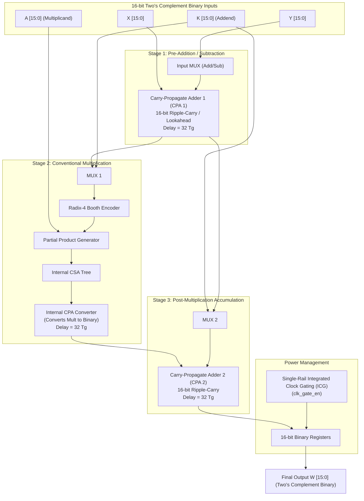

# Base Paper Architecture: Conventional Flexible Computational Component (FCC)

> **Base Paper Reference:**  
> *"Flexible DSP Accelerator Architecture Exploiting Carry-Save Arithmetic"*  
> **Authors:** Kostas Tsoumanis, Sotirios Xydis, Georgios Zervakis, and Kiamal Pekmestzi  
> **Journal:** *IEEE Transactions on Very Large Scale Integration (VLSI) Systems*, Vol. 24, No. 1, January 2016.  
> **Baseline Datapath Reference:**  
> *"A High-Performance Data Path for Synthesizing DSP Kernels"*  
> **Authors:** M. D. Galanis, G. Theodoridis, S. Tragoudas, and C. E. Goutis  
> **Journal:** *IEEE Transactions on Computer-Aided Design of Integrated Circuits and Systems*, Vol. 25, No. 6, June 2006.

---

## 1. Abstract & Overview of the Existing System

Digital Signal Processing (DSP) applications (including FIR filtering, IIR filtering, FFT, and discrete cosine transforms) require intensive chained operations combining addition, subtraction, multiplication, and accumulation. 

The **Existing System** described as the primary comparison baseline in the IEEE TVLSI paper is the **Conventional Flexible Computational Component (FCC)**. The FCC is a reconfigurable coarse-grained datapath designed to map primitive and chained arithmetic operations onto dedicated functional units operating strictly on standard **16-bit signed two's-complement binary numbers**.

While the FCC provides operational flexibility, its arithmetic execution pipeline suffers from a severe **Carry-Propagation Bottleneck**: every chained addition or multiplication stage requires converting intermediate values using a **Carry-Propagate Adder (CPA)**, leading to a long critical path delay ($140 \, T_g$) and elevated dynamic switching energy.

---

## 2. Existing System Hardware Architecture

The figure below illustrates the micro-architecture of the conventional FCC datapath (also available as high-resolution PNG: [`figures/fig_base_paper_existing_fcc.png`](file:///c:/Users/LENOVO/OneDrive/Documents/majar_project/1.Flexible%20DSP%20Accelerator%20Architecture%20Exploiting%20Carry-Save%20Arithmetic/1.Flexible%20DSP%20Accelerator%20Architecture%20Exploiting%20Carry-Save%20Arithmetic/figures/fig_base_paper_existing_fcc.png)):



---

## 3. Detailed Component Breakdown & Bottleneck Analysis

### 3.1 Two's Complement Data Representation
In the existing FCC architecture, all operands ($X, Y, K, A$) and intermediate variables are stored in standard 16-bit signed two's-complement binary:
$$X = -x_{15} \cdot 2^{15} + \sum_{i=0}^{14} x_i \cdot 2^i$$
Because data is non-redundant, every addition or subtraction requires carry bits to ripple sequentially from bit $0$ to bit $15$.

### 3.2 Pre-Addition Stage: Carry-Propagate Adder 1 (CPA 1)
To compute $(X \pm Y)$ prior to multiplication:
- An input multiplexer selects either $Y$ or its bitwise inversion $\sim Y$ with a $+1$ carry-in for subtraction.
- A 16-bit Carry-Propagate Adder (CPA 1) computes the sum.
- **Delay:** Using the standard Unit Gate Model ($T_g$ = inverter delay, Full Adder carry delay = $2 \, T_g$):
  $$T_{\text{CPA1}} = 16 \times 2 \, T_g = 32 \, T_g$$

### 3.3 Multiplication Stage: Conventional Radix-4 Booth Multiplier
The multiplier computes the product of multiplicand $A$ and the output of CPA 1 (or $K$):
1. **Radix-4 Booth Encoding:** Operates on 3-bit overlapping windows of the binary multiplier input.
2. **Partial Product Generation:** Generates 8 partial products: $PP_i \in \{0, \pm A, \pm 2A\}$.
3. **Internal CSA Tree:** Compresses the 8 partial products down to two vectors (Carry and Sum).
4. **Internal CPA Adder:** Because the FCC datapath is strictly binary, the multiplier **cannot output carry-save data**. It must use an internal 16-bit CPA to convert the product back to two's-complement binary before outputting!
- **Delay:**
  $$T_{\text{Mult}} = T_{\text{Booth}} + T_{\text{Tree}} + T_{\text{Internal CPA}} \approx 8 + 36 + 32 = 76 \, T_g$$

### 3.4 Post-Addition Stage: Carry-Propagate Adder 2 (CPA 2)
To compute the final accumulated result (e.g., $\text{Product} + K$):
- The binary output of the multiplier is fed into a third adder: CPA 2.
- CPA 2 ripples carries across all 16 bits again.
- **Delay:**
  $$T_{\text{CPA2}} = 16 \times 2 \, T_g = 32 \, T_g$$

### 3.5 Total Critical Path Delay Bottleneck
Summing the delays across the chained operation:
$$\begin{aligned}
T_{\text{crit, FCC}} &= T_{\text{CPA1}} + T_{\text{Mult}} + T_{\text{CPA2}} \\
&= 32 \, T_g + 76 \, T_g + 32 \, T_g \\
&\approx \mathbf{140 \, T_g} \quad (\mathbf{1.68 \, ns} \text{ in 65nm CMOS})
\end{aligned}$$

---

## 4. Supported Operation Templates in the Existing System

The existing FCC datapath configures internal multiplexers to execute 5 core DSP templates:

| Template | Mathematical Formula | Execution Path in Existing FCC |
| :---: | :--- | :--- |
| **T1** | $W = A \times (X + Y) + K$ | CPA 1 (Add) $\rightarrow$ Booth Multiplier $\rightarrow$ CPA 2 (Accumulate) |
| **T2** | $W = A \times (X - Y) + K$ | CPA 1 (Sub) $\rightarrow$ Booth Multiplier $\rightarrow$ CPA 2 (Accumulate) |
| **T3** | $W = A \times K + (X + Y)$ | Multiplier ($A \times K$) in parallel with CPA 1 ($X + Y$) $\rightarrow$ CPA 2 |
| **T4** | $W = A \times K + (X - Y)$ | Multiplier ($A \times K$) in parallel with CPA 1 ($X - Y$) $\rightarrow$ CPA 2 |
| **T5** | $W = A \times K$ | Multiplier ($A \times K$) bypassing CPA 1 and CPA 2 |

---

## 5. Quantitative Hardware & Energy Metrics (Existing System)

Evaluated under the Unit Gate Model and simulated in TSMC 65nm CMOS:

| Metric | Measured Value (Existing FCC) |
| :--- | :---: |
| **Gate Equivalent Area Complexity ($A_g$)** | **$3274.0 \, A_g$** |
| **Critical Path Delay ($T_g$)** | **$140.0 \, T_g$** |
| **Critical Clock Period @ 65nm ($T_{\text{crit}}$)** | **$1.68 \, \text{ns}$** |
| **Area-Delay Product (ADP)** | **$458,360 \, A_g \cdot T_g$** |
| **Continuous Dynamic Power (Un-gated)** | **$0.2510 \, \text{mW}$** |
| **Dynamic Power with Clock Gating (ICG)** | **$0.2270 \, \text{mW}$** *(9.58% saved)* |
| **Total Energy: 16-tap FIR Filter (`FIR16`)** | **$1038.04 \, \text{pJ}$** (272 cycles) |
| **Total Energy: 6th-Order Elliptic Filter (`ELLIPTIC`)** | **$261.04 \, \text{pJ}$** (64 cycles) |
| **Total Energy: 2nd-Order Volterra Filter (`VOLTERRA`)** | **$391.30 \, \text{pJ}$** (96 cycles) |

---

## 6. Comprehensive Comparison: Existing System (FCC) vs. Proposed System (FCU)

| Architectural Metric | Existing System (FCC - Base Paper) | Proposed System (FCU - Our Design) | Advantage of Proposed Design |
| :--- | :--- | :--- | :--- |
| **Arithmetic Format** | Standard Two's Complement Binary | Pervasive Carry-Save ($X^* = X_C + X_S$) | Avoids binary conversion bottlenecks |
| **Intermediate CPAs** | **3 CPAs** (Pre-add, Mult, Post-add) | **0 Intermediate CPAs** | Eliminates $O(N)$ carry ripple delay |
| **Pre-Addition Unit** | 16-bit CPA ($32 \, T_g$) | 4:2 Carry-Save Compressor ($4 \, T_g$) | **8× faster pre-addition stage** |
| **Multiplier Recoder** | Standard Radix-4 Booth (Binary only) | Direct CS-to-MB Recoder ($8 \, T_g$) | Directly recodes Carry-Save pairs |
| **Accumulator Stage** | Dedicated 16-bit CPA 2 ($32 \, T_g$) | Inlined into Multiplier CSA Tree | Fuses addend directly with 0 extra adders |
| **Boundary Converter** | Unnecessary (already binary) | Single 16-bit CStoBin Ripple Adder | CPA placed strictly at accelerator output |
| **Critical Path Delay** | **$140.0 \, T_g$** ($1.68 \, \text{ns}$) | **$40.0 \, T_g$** ($1.13 \, \text{ns}$) | **71.43% Delay Reduction (Over 3× faster)** |
| **Gate Equivalent Area** | **$3274.0 \, A_g$** | **$2624.0 \, A_g$** | **19.85% Silicon Area Savings** |
| **Area-Delay Product (ADP)** | **$458,360 \, A_g \cdot T_g$** | **$104,960 \, A_g \cdot T_g$** | **77.10% Overall Efficiency Gain** |
| **Clock Gating (ICG)** | Single-rail binary gating | Dual-rail Carry & Sum gating | Glitch-free clock suppression |
| **FIR16 Energy** | $1038.04 \, \text{pJ}$ | $754.05 \, \text{pJ}$ | **27.36% Energy Reduction** |
| **Elliptic Filter Energy** | $261.04 \, \text{pJ}$ | $167.18 \, \text{pJ}$ | **35.95% Energy Reduction** |
| **Volterra Filter Energy** | $391.30 \, \text{pJ}$ | $243.18 \, \text{pJ}$ | **37.85% Energy Reduction** |

---

## 7. How to Run the Existing System Simulation

To verify the Existing System independently, run:
```powershell
cd "1.Flexible DSP Accelerator Architecture Exploiting Carry-Save Arithmetic"
python -m existing_system.simulator
```

To run the comparative verification and metric analysis:
```powershell
python -m benchmarks.compare_metrics
```

